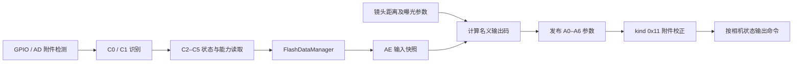

# GR IV 1.11 新热靴协议、输出计算与附件校正

## 结论与证据范围

**2026-10-13 实机补充：**用户执行原厂 SD 短诊断后，GF-2 回复 C1 `11 00`，建立了本次 GF-2 与 kind 0x11 的实机对应；C2=`01 00`、C3/C4=`00 00`、C5=`1A`。六项查询/恢复正常返回，用户确认普通图标与关机联动恢复。原始日志见[实机回复记录](2026-10-13-gr4-hotshoe-live-readings.md)。kind 0x12 的物理型号仍未知。

本轮只研究 GR IV 机身端。固定样本为 `samples/gr4_decoded.bin`，内部版本 `1.11.10.7`，SHA-256 为 `c4e597c7c9ca1bc181b30e35139ed90a4fd876ddcca14f12be0e00b6702233ae`。地址映射、设置菜单和新旧路径的基础证据见[上一轮报告](2026-10-12-gr4-flash.md)。

**机身的新热靴路径包含完整的附件识别、状态与能力读取、自动输出计算、附件专用校正和参数写入。最关键的输出命令是 A0，但其最终线上字节不能直接当作线性功率百分比，也不能对所有附件套同一 GN 换算。**

本报告区分三个层次：

- **代码确认**：命令字节、缓冲区长度、字段偏移、判断条件和数学运算，由原始 ARM 指令、调用及数据表确认。
- **物理解释推断**：Av/Sv、距离单位和名义 GN 编码，依据数学结构及官方产品说明解释，仍需通信与曝光实测。
- **未确认**：热靴触点位置/电压、SPI 相位与位序、kind 0x12 对应型号、C5 物理单位、实际发光曲线和 X 同步时序。

没有访问相机、修改固件或执行原始 ARM 指令。此次完成静态核对，不把离线数学解释计为实机验证。

## 从附件到输出的数据链



流程图只表示已追踪的控制参数链。实际发光触发与快门同步没有在图中补画为已确认路径。

| 环节 | 运行时地址 | 核心行为 |
| --- | --- | --- |
| 新接口选择 | `0x53771CC4` | 默认 ProjectType 2 使用 HotshoeControl |
| 附件识别 | `0x53A73250` | GPIO/AD 检测后执行 C0/C1；可被多次调用 |
| 输入通信 | `0x53A73448` | 读取 C2/C3/C4/C5，写入 FlashDataManager |
| 输入校正 | `0x53771ED8` | 对 kind 0x11 替换 C3/C4 的机身内存副本 |
| AE 输入快照 | `0x5367FB48` | 将识别、状态、范围复制到 AeFlashComDataAssist |
| 名义输出码 | `0x53680940`、`0x536784F0` | 自动/手动分支及范围裁剪 |
| 参数编码 | `0x53680D28` 的协议 0x10 分支 | 生成 A0–A6 的待发布字段 |
| 参数发布 | `0x5367FADC` | Assist → FlashDataManager |
| 输出校正 | `0x537720F8` | 只针对 kind 0x11，按相机状态修改 A0 |
| 命令输出 | `0x53A73638` | 按 CameraState 分派实际传输 |

## 附件检测与握手

`HotshoeControl +0x30` 是通信模式，`+0x2C` 是 AD 检测分档，`+0x38` 非零时跳过正常检测并清除 kind/协议状态。以下偏移均相对对象；不能作为固定 RAM 写入地址。

正常检测先读取 `m_GpioHotSdai`。其逻辑值非零时选择模式 3；否则通过 `0x53A731C4` 读取有效的 AD 数据（通道索引 1），计算 `n = (v × 180) >> 10`。

| AD 分档 | n 条件 | 路径 |
| --- | --- | --- |
| 1 | n > 134 | 模式 1，执行串行握手 |
| 2 | 106 < n ≤ 134 | 模式 2 |
| 3 | 75 < n ≤ 106 | 模式 2 |
| 4 | 45 < n ≤ 75 | 模式 2 |
| 5 | 15 < n ≤ 45 | 模式 2 |
| 6 | n ≤ 15 | 无有效附件，关闭既有通信 |
| 0 | AD 有效标志为零 | 无有效附件，关闭既有通信 |

分档 1 的起点可由整数公式推出为 `v ≥ 768`。这是 AD 数字值阈值，**不能据此选定识别电阻或电压**。当前没有 ADC 满量程电压与热靴网络的证据。

只有模式 1 继续走以下识别：

1. 开启 SIO，发送 `C0`，再发送一个 `00` 占位字节，在这个占位字节的接收位置期待 `A5`。
2. C0 回复不是 A5：kind、subkind、协议状态清零。
3. C0 回复为 A5：发送 `C1 00 00`，取两个回复字节为 kind、subkind。
4. kind 为 `11` 或 `12` 时，`FlashDataManager +0x14 = 0x10`；其他 kind 的协议状态为零。此处没有按 subkind 限制接受。

`11/12` 是十六进制编号，尚未用真实附件核对对应型号。模式 2、3 不进入当前自动闪光通信条件，不能直接解释成“另外两种兼容 TTL 模式”。

握手不是只在插入时执行一次。定期附件检查调用点 `0x53771514`、输入入口 `0x53A7346C`、输出入口 `0x53A73660` 都会调用检测函数。未识别/拆除路径不是把所有缓存字段全部清零：部分旧回复可保留，但协议状态会失效，分析时须一起看模式与协议状态。

## 传输帧和时间限制

`0x53A7308C(this, descriptor, tx, rx)` 使用 descriptor 的低字节作为命令，高字节作为 **payload 字节数**。例如 `0x02C1` 表示命令 C1 加两个数据字节，而非总长两字节。

```text
片选低 → 延时 → [命令，命令阶段回复丢弃]
          → 延时 → [payload 0，全双工收发]
          → 延时 → [payload 1，全双工收发] … → 片选高
```

- 模式 1 配置 `0x000186A0 = 100000`；SIO 开启 `0x53A37CC4` 调用分频器 `0x53ABC740`，计算 `clock / rate − 1`。据此推断名义速率为 **100 kHz**，尚无波形确认。
- 每次传输之前补足距上次结束至少 `200` 的计时值；片选拉低后和每个 payload 之前各忙等 `100`。均走计时模式 0。计时转换例程已定位，但没有完整核对硬件计数器频率，所以不把这些数字直接写成微秒或毫秒。
- C0–C5 读取时 payload 的发送缓冲区为零；命令阶段收到的字节不作为 C0 的 A5。附件应在后续数据时钟期间回复。
- A 系列写入也进行全双工接收，当前输出函数没有检查收到的字节作为确认。
- 该帧传输例程没有显式长度字段或 checksum。不能据此断言附件内部不检查参数或不在别处校验。
- 初始化绑定 `HotSclk / HotScs / HotSdai / HotSdao / SIO`，另有按硬件分支绑定的 HotCtl/HotCtlEn。逻辑名称未转换成物理触点布局；还没有可以直接照接的针脚图。

## 命令字典与字段消费

表 `0x54354054` 共 13 条命令，下列方向表示有效 payload 的用途。FlashDataManager 的读字段是原始传输结果，kind 0x11 随后会覆盖其中部分值。

| 命令 | payload | 方向 | Manager 偏移 | 代码确认/解释边界 |
| --- | --- | --- | --- | --- |
| C0 | 1 | 附件 → 机身 | `+74` | A5 识别回复 |
| C1 | 2 | 附件 → 机身 | `+75/+76` | kind/subkind |
| C2 | 2 | 附件 → 机身 | `+77/+78` | 状态和标志；第一字节 bit0 被 AE 状态查询消费 |
| C3 | 2 | 附件 → 机身 | `+79/+7A` | 自动输出码下限 L/上限 U；参与裁剪 |
| C4 | 2 | 附件 → 机身 | `+7B/+7C` | 第二字节作为手动全量参考及手动上限；后续追踪确认两字节也进入程序曝光的能力上下界计算，GN 物理解释待测 |
| C5 | 1 | 附件 → 机身 | `+7D` | kind 0x11 校正输入 t；不是已确认温度/电量单位 |
| A0 | 1 | 机身 → 附件 | `+6C` | 主要输出控制码，发送前可能有专用校正 |
| A1 | 1 | 机身 → 附件 | `+6D` | 灵敏度编码候选；数学式已还原 |
| A2 | 1 | 机身 → 附件 | `+6E` | 光圈编码候选；数学式已还原 |
| A3 | 1 | 机身 → 附件 | `+6F` | 带符号的校正字段，负分支使用 bit7 标志及低 7 位幅值 |
| A4 | 1 | 机身 → 附件 | `+70` | 来自镜头参数对数的字段；具体物理含义未确认 |
| A5 | 1 | 机身 → 附件 | `+71` | AE 默认置零；普通批量输出不发送它 |
| A6 | 2 | 机身 → 附件 | `+72/+73` | 自动关机时间设置相关，默认 `01 02`，高字节在前 |

C2 第一字节 bit0 的提取函数为 `0x537727A4`，协议 0x10 下由 `0x5367F410` 查询，**可作为 ready 候选，尚未完成对充电等待全链的确认**。第二字节低三位及 bit3/4/5 各有提取函数；bit3/4/5 复制到 Assist `+33/+34/+35`。本轮不擅自命名为电池、温度、倾斜等状态。

A6 的语义依据不仅是默认值：`0x53771364` 的分支使用诊断文本 `CF No AutoPowerOff Time`，将参数发布到同一字段，并以状态 18 输出 A6。因此它不能当作已确认的发光触发命令。

2026-10-13 补查电源控制：[电源专项报告](2026-10-13-gr4-hotshoe-power.md)已将关机步骤 `0x601`（`SHUT_DOWN_STEP_PREPARE_SHUT_DOWN_START`）连接到附件请求 15、A6 参数 `0x0100`、状态 18 及 `A6 01 00` 输出路径。正常默认值为 `01 02`。这建立了机身关机与 A6 的静态联系；灯端如何处理、计时单位及是否真正断电仍未实测，也不能将 `01 02` 反过来认定为开机指令。

官方 GR IV 操作手册第 70 页的 GF-2 安装步骤要求先开启相机，再开启闪光灯，支持正常使用中需分别开机的结论。[官方操作手册](https://www.ricoh-imaging.co.jp/resources/english/support/man-pdf/gr-4_en.pdf) 当前定位的主命令和调用链没有明确的远程开机命令。通信开启例程操作片选/时钟/输出 GPIO 并开启 SIO，不能把名称 OpenCommunication 当成灯电源开启。HotCtl/HotCtlEn 也不能仅凭名称解释为附件电源开关。休眠唤醒或独立 GPIO 唤醒仍需灯端资料及实物波形；“没有定位到开机命令”不等于证明不存在任何唤醒机制。

还有**主命令表之外**的扩展读取：`0x53A73554` 使用 `0x53B4E7B8` 的 descriptor `0x0B50`，发送命令 `50`、11 个 payload，首个发送 payload 为 `21`，其余为零。回复最后四字节按高字节在前组装到 Manager `+80`。由 `0x53771DC0` 接入新路径，具体字段用途尚未还原；只实现主表会遗漏这个机身调用。

## 相机状态决定发送什么

输出 `0x53A73638` 在再次识别后要求模式 1、协议状态 0x10，再按 CameraState 跳转表分派。

| CameraState | 行为 |
| --- | --- |
| 8、9 | 只发送 A1 |
| 10 | 诊断并返回 false |
| 11 | 返回 success，**没有发送任何命令** |
| 12、13 | 顺序发送 A0 → A1 → A2 → A3 → A4 → A6，每条独立片选帧 |
| 14、15、16、17 | 诊断并返回 false |
| 18 | 只发送 A6 |
| 其他 | 无效状态诊断/false |

状态 13 传给 kind 0x11 校正函数的分支参数为 1，12 为 0。这是调用条件与校正分支的对应；该另一分支是否对应红眼发光，以及其他编号是否对应半按、开快门等物理事件，仍需核对。

上层 `0x53770A30` 在调用输出后发送包含状态编号的完成事件（ID `0x2220083A`），随后根据函数返回值决定是否重试。该软件事件不能单独证明附件成功收到了输出命令，也不能当作发光成功反馈。

## 自动输出计算：已还原的数学结构

这里的 `F[k]` 表示 AE 内部对象偏移 k 的浮点值，**不是给未知字段杜撰的变量名**。

`0x536784F0` 的计算为：

```text
X = F[84] + F[D4] − (F[D8] − 5) + F[E4] + B
B = (flag_1 ? 2 : 0) + (flag_2 ? 3 : 0)
```

`0x53680940` 自动分支计算 `q = VCVT_U32(52 + 8 × X)`，再以 C3 的 L/U 裁剪。VCVT 是向零取整的浮点转换，没有额外四舍五入；正常有限、非负值可近似写成 `trunc`。负值、溢出与 NaN 不应自行用普通 Python int 替代 CPU 语义。比较使用无符号整数，最后取低 8 位，同时记录欠量/超量标志及差值。

距离项有更完整的来源：`0x53681F68` 调用镜头距离接口 `0x5394252C`，随后 `0x53681E6C` 执行：

```text
F[84] = logf(lens_value / 1000) / logf(sqrt(2))
      ≈ 2 × log2(lens_value / 1000)
```

sqrt/logf 包装函数中的诊断文本已核对。镜头接口有 30000 的上限。将镜头返回值解释为毫米、`F[84]` 解释为以米计距离的平方对数，与除以 1000、30000 上限和官方“距离联动”说明一致；**距离参考点与失焦/无穷远等特殊值的实际行为仍未实测**。

如果 `F[D4] = Av = 2log2(N)`、`F[D8] = Sv = 5 + log2(ISO/100)`，则名义计算符合：

```text
q_nominal ≈ 52 + 8 × [2log2(d_m) + Av − (Sv − 5) + correction]
GN_100_requested ≈ 2^((q_nominal − 52) / 16)
```

这部分 Av/Sv 的命名及 GN 绝对标定属于**强数学解释，未做物理标定**。每 +8 码值对应 +1 档能量、GN 乘 √2；距离加倍使名义码值 +16，ISO 翻倍使名义码值 −8，光圈缩一档使名义码值 +8（均假设其他项和上下限不变）。这是解释名义量，不是所有 A0 线上字节的直接换算表。

官方明确说明 GF-2 的 ISO AUTO 模式联动 GN/ISO，固定 ISO 时也按距离控制 GN；不支持 PENTAX P-TTL。这与上述代码结构相符，**不能从残留的预闪名称推导出 GR IV 已启用 TTL 预闪测光闭环**。[官方功能说明](https://www.ricoh-imaging.co.jp/japan/products/gr-4/feature/03.html)

## 手动输出与其他参数编码

当 AE `+0x5DC` 非零时，主输出分支改为：

```text
q_manual = C4[1] + trunc_signed(8 × F[68])
L = C3[0]
U = C4[1]                 # 此时不用 C3[1] 作上限
```

`F[68]` 与手动控制值均从机身公共属性流读入。上一轮已确认 `1/1 → 0 EV`、`1/4 → −2 EV`，因此**校正前**四分之一输出名义码比全量低 16；没有范围裁剪时成立。不能据此断言最终线上 A0 相差 16。

协议 0x10 下的其他输出构造如下：

| 字段 | 数学/常量 |
| --- | --- |
| A0 | 上述 q；构造入口遇状态 10 时另置 `40`，但当前 HotshoeControl 不接受状态 10 输出 |
| A1 | 取低字节 `VCVT_U32(32 + 8 × (F[D8] − 5))`；Sv 解释成立时 ISO100 为 `20`、ISO200 为 `28` |
| A2 | 取低字节 `VCVT_U32(68 + 8 × F[D4])`；Av 解释成立时 Av3 为 `5C` |
| A3 | 以 F[68] 的符号选分支，实际数据取 F[DC]；负分支为 `80 OR (VCVT_U32(−8×F[DC]) AND 7F)` |
| A4 | 取低字节 `VCVT_U32(8 × F[80])`；F[80] 来自另一镜头参数经 log2 处理 |
| A5 | 默认 0，另有上层事件可改该字段 |
| A6 | 默认 16 位值 `0102`，发布时拆成 `01 02` |

A3 的负分支是**符号位加幅值，不是二进制补码**。而且符号判定和数据字段不同，尚不能把它简写成对任意闪光补偿值都适用的通用编码器。

## kind 0x11 专用校正：线上 A0 与名义 q 不同

这是必须保留的机身行为，不能只实现识别成功后的原样转发。以下 t 是 C5 回复的数值，不赋予物理单位。

输入完成后 `0x53771ED8` 对 kind 0x11 执行：

```text
Manager.C4 = [0, 77]
Manager.C3 = [4, U(t)]
U(t) = trunc(70.8 + 0.247t − 0.00258t²)  if t ≤ 24
     = 77                                if t > 24
```

**被写成 `[4,U(t)]` 的是 C3 内存副本，C4 是 `[0,77]`。** 两个 setter 分别为 `0x537727E0` 和 `0x537727FC`，已单独核对跳转，避免把自动范围和手动参考混为一谈。附件线上真实回复仍需保留作对照，不应只抓机身校正后的内存值。

状态 12 的常规输出 `0x537720F8 → 0x53772050` 使用二维多项式：

```text
P(q,t) = 6.968 − 0.432t + 0.007362t²
       + (1.316 − 0.01457t)q
       + (0.0001845t − 0.004164)q²
h = low_byte(VCVT_U32(P(q,t) + 0.5))
A0_wire = min(77, max(C3[0], h))
```

二次项的符号依据 `VNMLS` 的“乘积减原目标值”语义；已对照 [Arm 指令参考](https://documentation-service.arm.com/static/6245c734b059dc5ff9a8bdab)。这是普通 VFP 运算序列的数学整理；精确边界行为还要考虑逐步浮点舍入和转整数后取低字节的顺序。

有一个绕过多项式的条件：机身手动控制属性值为 1 且 q 等于 C4[1]，保留全量码。因此正常输入校正后，手动全量 q=77 可直接发送 77；四分之一 q=61 则通常仍会校正。以 t=0 的离线数学例子，P(61,0)+0.5 为 72.249756，向零取整为 72。**这个例子说明名义减 16 不等于线上减 16，不是已测得的 GF-2 发光曲线。**

状态 13 使用另一校正：按 t 取 decrement：`0→4`、`1…2→3`、`3…5→2`、`6…10→1`、`>10→0`，从既有 A0 减去后取低字节，并保存到 Manager `+84`。这里没有常规分支的同一裁剪过程。

kind 0x12 在这两个专用函数中直接返回，不做上述校正；这只说明分支差异，不证明其物理型号或能接受任意输出范围。

## 0x12 是否表示下一款闪光灯：后续线索核查

2026-10-12 针对该问题补查。**证据支持“固件接受另一种可参与自动输出的附件类别”，还不支持“理光已经决定推出下一款灯”或“其型号是 GF-3”。2026-10-13 后续实测已确认本次 GF-2 的 C1 为 `11 00`。**

支持可扩展附件的代码线索：

- `0x53A73424` 将 kind 减去 0x11，`0x53A7342C` 做无符号 `≤1` 判断；0x11/0x12 都进入协议状态 0x10。0x12 是接入共用 AE/输出路径的实际条件，不是只存在于名称表的编号。
- 输入/输出校正只检查 0x11。0x12 不被这两处覆盖为 C3 `[4,U(t)]` 和 C4 `[0,77]`，也不经过这一层输出多项式及 77 上限。这给附件自己报告不同输出能力留下了条件；不保证其他所有 AE/硬件环节都没有限制。
- 新追踪到 `AeProgramDiagramFlash` 在 `0x5367D660/0x5367D680` 分别读 C4[0]/C4[1]，计算 `(code − 52) × 0.125`，参与后续浮点曝光约束。`0x53681C58…0x53681C74` 在协议状态 0x10 下开启该能力路径，因此两个 kind 都满足这一条件。C4 不只是用于手动输出的单一参考值，而有成对能力界值的消费者。这与可由不同附件报告不同 GN 范围的设计相符，绝对 GN 单位仍需实测。
- C1 第二个字节被保存；识别入口没有限制其取值。它提供额外分类信息，但未发现能据此指定品牌/型号的命名表，不能自行称为版本号。

没有找到的型号证据与容易误读的内容：

- 在解码载荷的 ASCII、UTF-16LE/BE 中检索 GF-3/GF3。随后对裸 `GF3` 的 9 处 ASCII 命中[逐处核查文件归属和指令边界](2026-10-12-gr4-gf3-byte-matches.md)：8 处为 Thumb 指令序列，1 处属于 NXP 固件二进制且内部含义未解出，未找到有效产品名；不能拿原始字节搜索命中作新品证据。
- UTF-16 文本中确实有 GF-2，但抽查的是多语言 `GF-2 Flash Mode` 菜单资源，未建立与 C1 kind 的映射。资源存在不等于当前型号开放该菜单或某编号对应 GF-2。
- 未定位到仅为 0x12 使用的新命令表、独立校准曲线或型号标签。目前两个 kind 共享协议 0x10，不能把 0x12 解释成新增 TTL、HSS 或无线引闪能力。

公开资料核查：当日[理光 GR IV 官方附件页](https://www.ricoh-imaging.co.jp/japan/products/gr-4/accessories/)仍列 GF-2；[官方产品新闻列表](https://news.ricoh-imaging.co.jp/rim_info/products/)中查询到的 GR IV 专用闪光灯发布为 2025-08-21 的 GF-2，未检索到 GF-3 或另一款新灯开发公告。这个查询结果不能排除尚未公布或未上市的计划。

合理解释仍有多种：未来量产灯、现有附件的硬件修订、开发测试附件，或另一种兼容附件类别。当前数据不足以给它们排序，也不能将接受第二个类别直接换算为上市概率。GF-2 为 0x11 已由本次实物回复确认；仍需要 0x12 实物回复、明确产品字符串或官方公告才能确定另一类别的身份。

## 需要进一步验证的异常路径

**新路径没有把底层串行失败可靠地传递为通信失败。** `0x53A384F4` 对发送/接收寄存器轮询，单阶段最多 `0x10000` 次，超时返回 0，且没有写入 RX 缓冲。传输函数 `0x53A7308C` 在每字节之前把 RX 临时值设为 `C9`，忽略 SIO 返回值并复制该字节。因此字节失败可以变成上层数据 C9，而不是明确的失败状态。

输入 `0x53A73448` 在模式/协议条件满足后，完成四条调用就返回 1。若 C0/C1 已成功而随后的 C2 数据字节超时，C2 首字节可能为 C9，其 bit0 恰好为 1，AE 的该状态查询仍可能读到“1”。输出分支也没有验证逐字节收发或附件确认。

这构成**静态异常传播问题及待实测故障假设**。尚未模拟寄存器故障、确认所有上层门控或观察真实机身，所以不称为已经复现的拍摄 bug。正常接收的数据恰好为 C9 时也没有办法仅凭值判断发生过超时。旧路径打印的 ExtFlashInput/Output TIMEOUT 不能拿来证明新路径已处理这一情况。

## 复现与剩余边界

新增[离线审计脚本](../../tools/audit_gr4_hotshoe.py)在基础审计之外核对 28 个代码窗口，合计 **51 个指纹窗口、24 条直接分支、13 条主表命令**，并从样本读出输出状态表、AE 常量、专用多项式系数和扩展读取 descriptor。报告元数据中的命令解释是静态研究标注，不是自动反编译出来的物理协议规范。

```sh
python3 tools/audit_gr4_hotshoe.py samples/gr4_decoded.bin \
  --output /tmp/gr4-hotshoe-audit.json
```

脚本仅接受固定样本哈希，输出文件必须不存在。检查通过表明报告依赖的原始字节和调用关系一致；没有执行机身逻辑或证明硬件兼容。

GR IV 端剩余验证的优先级：

1. 记录真实 GF-2 的 GPIO/AD 检测、C0/C1 编号、C2–C5 回复及扩展命令 50，确认触点、电平、位序、时钟相位和计时单位。
2. 固定 ISO/光圈/焦点距离，分别采 AUTO、1/1、1/4 的 A0–A6；将名义码、C5 校正、最终线上码和实际光量对应。
3. 同时记录 X 同步、红眼闪光和主闪光；确认参数完成到触发的时间窗口、充电等待消费和电子快门门控。
4. 在可控通信故障下确认 SIO 失败、C9 数据、上层完成事件及是否允许继续拍摄的关系。

当前可以据此继续还原机身协议，尚不足以按固定字节表直接制作可用附件。尤其不能用 A0 的名义 GN 公式跳过 kind 专用校正，或把 A6/软件完成事件作为主闪触发。

本轮验证结果：静态审计通过；三个改动/截断样本被拒绝；已有输出文件的拒绝覆盖行为通过检查；A3 位运算与上述数值示例做了独立代数复核。全部为本地离线验证，未连接设备。
