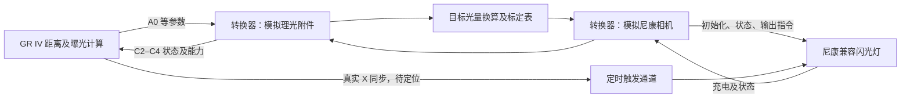

# GR IV 光量输出 → 尼康 i-TTL 灯端控制：通用可行性研究

2026-10-13。按用户要求暂不指定尼康灯或引闪器型号。本轮为本地固件证据与公开原始研究的对照，没有连接相机或闪光灯，也没有验证转换器。

**结论：把 GR IV 算出的目标光量转换成尼康兼容灯的主闪输出指令，有固件条件和他人实测先例支持，值得制作原型。现阶段可争取的是“GR IV 根据距离自动计算，转换器控制尼康灯执行”，尚不能称为 GR IV 获得了尼康预闪 TTL 测光。** 优先研究 kind `0x12`，但机身实物能否接受模拟附件、曝光范围是否完整生效、灯端是否能省略测光预闪，都需要验证。

## “TTL 就是告诉灯要多少亮度”准确到哪一步

对于本轮讨论的现代尼康 i-TTL，控制过程可分为：

1. 灯按要求发出测光预闪。
2. 相机测量经镜头进入的反射光，计算主闪需求。
3. 相机与灯通信，控制主闪光量并同步拍摄。

尼康官方说明监测预闪用于测量主体反射光、调整闪光输出。[尼康 i-TTL 官方说明](https://onlinemanual.nikonimglib.com/p1100/en/10-03.html)

用户的设想抓住了第三步：已经有目标光量时，可以探索复用灯的通信和调光能力。第二步不会因为灯支持 TTL 而自动出现在 GR IV 内。GR IV 的已有路径依据距离、曝光参数和附件能力计算目标值；理光也明确描述 GF-2 为距离联动 GN 控制。[理光 GF-2 功能说明](https://www.ricoh-imaging.co.jp/japan/products/gr-4/feature/03.html)

本轮不把旧胶片 TTL、D-TTL、光学无线 AWL、无线电 AWL 和第三方无线协议混为一个接口；初始原型以尼康兼容热靴灯的有线 i-TTL 通信为研究对象。

## 两端已有的依据

### GR IV 端：固定样本静态证据

本地样本为内部版本 `1.11.10.7`，SHA-256 为 `c4e597c7c9ca1bc181b30e35139ed90a4fd876ddcca14f12be0e00b6702233ae`。原始字段、地址和验证边界见[热靴分析](2026-10-12-gr4-hotshoe-protocol.md)。

- C0 后续数据字节期待 A5；C1 回复的 kind 为 `0x11` 或 `0x12`，均进入协议状态 `0x10`。
- C3 提供自动输出上下限；C4 第二字节作为手动全量参考，两个字节也进入程序曝光的能力界值计算。
- A0 是主要输出码。校正前名义量符合 `q ≈ 52 + 8 × X`，曝光解释下每 +8 码对应 +1 EV；绝对 GN 标定仍属于待实测解释。
- kind `0x11` 改写范围，并按 C5 和多项式校正 A0；kind `0x12` 在这两处专用校正中直接返回。
- 物理针脚、电平、时钟相位/位序、实际 X 同步和 CameraState 的物理事件仍未建立。

这些条件让机身“接受一个报告自身能力的模拟附件”成为合理实验方向。它们没有证明 `0x12` 是特定型号，也没有证明任意输出范围能通过全部 AE 门控。

### 尼康端：他人原始实测，非官方协议规范

[Nikon Flash Analysis](https://off-the-clock.timothy-nicole-marks.com/computers-and-electronics/nikon-flash-analysis)作者在 Quantaray 兼容灯上测量了热靴通信，并报告用 Atmel AVR 控制不同光量发光。这是“单片机代替相机驱动灯端”的直接先例，不能外推到所有型号。

Hervé Queval 的 D7000/SB-900 实测报告记载了识别、能力、状态交换、D3 输出设置及随后 X 同步触发。其报告还指出灯提供时钟、数据线双向、长帧有校验，D3 末尾有来自灯的确认。[原始协议研究](https://www.springbokphotography.com/blog/2020/4/21/metz-to-nikon-arduino-conversion)

可用于抓包定位的**候选交换**：

```text
模拟相机 → 灯：D3  模式字节  输出字节 PP
灯 → 模拟相机：D3（确认候选）
随后：X 同步触发主闪
```

这是研究线索，不能直接当通用固件发送表。该报告同一篇文章前段写 PP=`58…7F`，后段对 SB-900 写 `54…A8`、1/12 EV；短帧字节数的描述也有不一致。已有资料不足以宣布统一的 PP 区间、完整帧格式或步长，必须对选定设备核对方向、字节数、模式、确认和光量曲线。

另一个硬件研究者报告约 62.5 kHz，而上述研究给出每个时钟约 32 µs。不能选一个频率便推广到所有设备。[独立硬件测量](https://karu2003.wordpress.com/2013/01/17/nikon-ittl-protocol-analysis-hardware/)

## 转换器的职责



图中为拟议架构；箭头不代表已验证的物理连接。两端同名命令的含义不能按字节名称对应：例如理光 A0 是输出，公开尼康研究中的 A0 是灯的状态回复。

| 项目 | 理光端已有线索 | 尼康端公开研究线索 | 对转换器的影响 |
| --- | --- | --- | --- |
| 角色 | 模拟附件，响应机身 | 模拟相机，初始化灯 | 同时维护两个独立状态机 |
| 数据线 | 分开的输入、输出，帧内全双工 | 双向数据线，按命令及字节切换方向 | 不能接线直通 |
| 时钟 | 机身 SIO 输出，配置推断约 100 kHz | 被测设备由灯提供时钟 | 两端需要独立计时与缓冲 |
| 能力及状态 | C2–C5；ready 完整含义待核对 | 型号、能力、状态、确认 | 保留真实灯状态，不能恒报已就绪 |
| 目标及触发 | A0 与实际触发分开研究 | 输出设置与 X 同步分开 | 收到 A0 时只准备参数，不能直接主闪 |

本表的尼康协议细节来自上述 Queval 原始研究，属于所测设备观察。硬件还需独立测量两端的电平、方向、上电状态和 X 触点行为，再选择双向缓冲及触发驱动电路；没有可供直接照接的针脚图。

## 为什么优先验证 0x12

如果选择 `0x11`，转换器收到的是经过附件专用公式修正的码，而且机身内部范围会被改成该类别的固定设定。要恢复名义需求，必须保留自己回复的 C5、区分普通与另一状态分支、处理全量绕过条件；由于取整和限幅，反算还可能多对一。

`0x12` 在已定位的两处函数中避免了这些行为，因此更适合报告尼康灯的实际上下限，并由转换器定义光量对应关系。C3、C4、C5、subkind 和状态标志不能随意填零：需要真实附件基线和完整消费者核对，才能制定回复。

这是对接入方式的工程判断，不是对 `0x12` 产品身份的推断。也不把“跳过两处校正”扩大为“整个机身绝无其他校正”。

## 光量换算及真正的上下限

在名义 GN 解释成立、固定灯头角度/照明方式、直射、ISO100 参考条件下：

```text
G_requested ≈ 2^((q − 52)/16)
fraction_requested ≈ (G_requested / G_full)^2
```

`fraction_requested` 是相对于该灯同一照明条件下全量的光量比例。实际发送的尼康 PP 要查标定表，不能把理光 q 原样发送，也不能把 PP 当线性百分比。若 q 已包含闪光补偿，不得在未核对字段消费前再把 A3 加一次。

假设某灯**实测全量 GN32、最低 1/128**，以下只是数学示例，不代表某款尼康灯：

| 需求 | 名义 q（近似） | 相对这盏灯全量 | 是否落在假设范围 |
| --- | --- | --- | --- |
| GN32 | 132 | 1/1 | 是 |
| GN8 | 100 | 1/16 | 是 |
| GN3 | 77.36 | 约 1/114 | 是，接近最低 |
| GN0.125 | 4 | 1/65536 | 否，远低于最低 |

此灯最低 GN 为 `32/√128≈2.83`，其名义 q 范围约为 `76…132`。所以它不能复现小灯可能需要的极弱输出；C3/C4 应在验证字段语义后报告实际能力，而非假装具有 `4…77` 的范围。上下限应向实际可达范围内取整，边界需留出测量误差。

灯头角度改变会同时影响照射覆盖和 GN。尼康官方 SB-5000 规格就分别给出 35mm 与 200mm 灯头位置的不同 GN；不能拿长焦灯头标称 GN 用于 GR 的广角直射。[尼康官方 GN 条件](https://imaging.nikon.com/imaging/lineup/speedlights/sb-5000/)

初始标定应固定广角覆盖、灯头和附件，逐个灯端码测量光量，建立单调的 `PP → GN/相对光量` 表及可达范围。仅测发光脉宽不足以建立准确光量；可用闪光测光表，或经过标定的积分光电测量。后续才能研究变焦、柔光附件和重复发光下的变化。

## 能达到的曝光效果

机身已根据对焦距离、光圈、ISO 算出目标，转换器又正确标定灯的输出时，直射主体的自动曝光是合理目标。近距离超出灯端最低输出、距离估计不准，都会导致曝光偏差。

跳闪、离机、柔光损耗及复杂反射改变了闪光传播路径。现有距离模型无法自动知道这些变化；灯设置为 i-TTL 也不会替机身完成镜头内测光。若要真正的预闪 TTL，必须额外建立 GR IV 预闪反射光的采集、时间同步和算法接口；当前固件证据未完成这一闭环。

## 原型验证顺序和通过条件

1. **尼康灯端独立实验。** 选定型号后，先在原厂机身上抓取初始化、状态、输出、确认及 X 同步；再由单片机复现。通过条件是同一硬件在重复触发时可稳定产生至少三种可测光量。必须单独验证能否省略 D7/D8 预闪；若灯状态机需要预闪，记录最小前置流程及恢复时间，不能把无意义预闪称为测光。
2. **GR 端附件模拟。** 先取得 GF-2 的真实波形和回复基线，再模拟 C0/C1 `0x12`；核对 C2–C5、扩展读取及重复识别。通过条件是机身稳定识别，并且所报告范围能进入 AE 和输出计算，不只完成一次握手。
3. **标定与范围。** 固定照明条件测 PP 表，确认名义 GN 绝对标定。改变距离、ISO、光圈时核对 A0 与测得光量的关系，并确认上下限时机身的处理。不得把未达最低输出默默称为曝光准确。
4. **整机同步。** 对齐真实 X 触点、A0–A6 参数完成、尼康输出确认及主闪波形。参数要提前装载并确认；X 到来走确定延时的触发通道。GR A0 先于其余参数发送，需要缓存更新及时间戳，避免混用前一张的参数。
5. **曝光验证。** 先用低速快门（例如 1/60 秒）建立直射曝光基线，再测试更快快门、充电不足、拆除、休眠及连拍。GF-2 的同步能力不能直接转移给较长主闪脉冲的尼康灯；高速时应测整段快门曝光窗口，不能默认支持 FP/HSS。

尚未指定实物型号，因此本轮没有生成可发送的尼康帧固件、接线电路或兼容型号清单。通用研究已明确可行方向：**kind 0x12 的能力报告 → GR 名义目标 → 实测光量标定表 → 灯端输出设置及确认 → X 同步主闪**。第一项具有本地代码依据，中间硬件及输出先例来自他人原始研究，完整桥接仍待原型验证。
